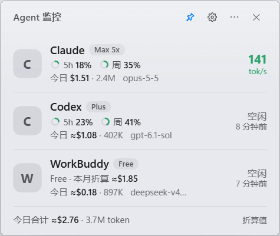

# Agent Monitor

English · [中文](README.md)

A Windows desktop floating widget that shows, side by side and in real time, the token speed (per model), 5-hour / weekly quota, and today's cost and token usage of **Claude / Codex / Antigravity / WorkBuddy / ZCode / OpenCode**. Apple-style look, low resource use. It collapses into a pill when the mouse leaves (docking to the top / bottom / left / right edge) and expands when the mouse comes back.



> This project is not affiliated with or endorsed by Anthropic, OpenAI, Google, Tencent or any other vendor. Product names are used only to describe where the data comes from; all trademarks belong to their respective owners.

## Features

- Multiple agents on one screen: today's cost, tokens, current model; 5h / weekly rings when quota data is available
- Live speed: one big tok/s number when a single model is generating, a per-model list when several are
- Click an agent for a 14-day bar chart, cycle / month-end projections, subscription payback ratio and a per-model breakdown
- Auto-collapse into a pill (shows the 5h percentage when idle, the speed while generating); vertical or horizontal depending on the docked edge
- Only agents detected on this machine are shown; you can hide any of them in Settings
- Light / dark / follow system; Settings for plans, launch at login, always-on-top, etc.

## Install

Download from [Releases](../../releases) (the Tauri build, from v0.2 on: small, system acrylic blur, more agents):

| File | Description |
| --- | --- |
| `Agent Monitor_x.y.z_x64-setup.exe` | Installer (~4 MB, per-user, no admin needed); launch at login supported; bundles the WebView2 bootstrapper, which installs WebView2 online if the system lacks it |
| `Agent-Monitor-x.y.z-portable-x64.exe` | Single-file portable build (~6 MB), just double-click; needs WebView2 on the system (built into Windows 11) |

> On first run Windows SmartScreen may warn about an "unknown publisher" (the project has no code-signing certificate). Click "More info → Run anyway".

> If you ran the Electron build (v0.1) from source: both share the same name and **data directory** (`%APPDATA%\token-widget`) and cannot run at the same time. Quit / uninstall it before installing the Tauri build; your history is kept.

### Build from source (Tauri)

Requires stable Rust + Node.js:

```bash
cd tauri
cargo test -p agent_core       # data-engine tests
npm install && npx tauri build # NSIS installer: target/release/bundle/nsis/
```

### Run from source (Electron build, v0.1)

The earlier Electron implementation: no longer released as installers, supports only the first four agents. Requires Node.js 22+.

```bash
npm install
npm start          # dev run ("launch at login" is unavailable in dev mode)
npm test           # run the tests
npm run dist       # build installer + portable into dist/
npm run stats      # CLI reconciliation (-- --fresh ignores the cache and rescans everything)
```

## Usage & settings

- Tray icon: left-click toggles the widget; the right-click menu has always-on-top, launch at login, pricing / plan config, full rescan and quit
- Drag the title bar to move it (position is remembered); if the card is within 60px of a screen edge when it collapses, it docks to that edge
- Pin icon (top right): keep it expanded, no auto-collapse
- Gear icon: per-agent plan (auto / preset / custom monthly price), visibility, appearance, launch at login, auto-collapse, always-on-top, Antigravity quota, Claude quota hook

### Data sources

| Agent | Source | Quota |
| --- | --- | --- |
| Claude | `~/.claude/projects/**/*.jsonl` | needs the statusLine hook (see below) |
| Codex | `~/.codex/sessions`, `archived_sessions` | 5h / weekly quota is in the logs |
| Antigravity | `~/.gemini/antigravity/brain/*/…/transcript_full.jsonl` | optional: local language service (5h only) |
| WorkBuddy | `~/.workbuddy-ai/projects/**/*.jsonl` | credits are not available locally |
| ZCode (Tauri build only) | `~/.zcode/cli/db/db.sqlite` (read-only) | no quota data locally; format taken from community docs, not verified on a real ZCode install |
| OpenCode (Tauri build only) | `~/.local/share/opencode/opencode*.db` (read-only, 1.14+) | no quota data locally; format taken from community docs, not verified on a real install |

Agents that are not installed are not shown: the card list, the settings page and the tray menu only list agents whose data exists on this machine.

Planned: DeepSeek Harness (`dsh`, data under `~/.dsh/sessions/`). It is in developer preview with no public log-format documentation, so support will be added once someone shares a real (redacted) session file — please open an issue.

## Privacy

- **Everything is processed locally. Nothing is uploaded and there is no telemetry.**
- Only the local logs listed above are read; cache and settings live in `%APPDATA%\token-widget\`.
- **Antigravity quota (optional, off by default):** when enabled, the app reads the command line of the Antigravity language-server process to obtain its local API token and only talks to `127.0.0.1`. The token stays in memory — it is never printed or written to disk. This is an undocumented internal API that may change between versions; on failure the app silently falls back.
- **Claude quota hook (optional):** when enabled in Settings, `tools/claude-statusline.js` is copied to `%APPDATA%\token-widget\` and the `statusLine` entry in `~/.claude/settings.json` is modified. The file is backed up as `settings.json.bak-<timestamp>` first, and **an existing statusLine of yours is never overwritten**. The hook only stores quota percentages and reset times.
- Plan detection extracts only the plan field (account type from `~/.claude.json`, the plan claim inside the Codex `auth.json` token). No token or e-mail is stored or printed.

## About the cost numbers

**Amounts shown are "equivalent value" computed from each vendor's public API prices — NOT what you are actually charged.** Subscribers do not pay these amounts; they are only meant to gauge usage and whether a subscription "pays for itself". `≈` marks an estimated price (some new models have no verifiable public price). The price table is `core/pricing.default.json`; override it in `%APPDATA%\token-widget\pricing.user.json` (takes effect on save). Monthly plan prices are in `core/plans.default.json` and can be overridden in Settings or `plans.user.json`.

Other conventions:

- Speed = output tokens in the last 60 s ÷ generation time (taken from log timestamp differences; Antigravity only has second-level precision, so it is an estimate); a request within the last 20 s counts as "generating"
- Claude output = log `output_tokens` + `thinking_tokens` (matches the official totals when reconciled)

## Known limitations

- **Claude 5h / weekly quota only works with the command-line Claude Code — the desktop app does not trigger the hook.** This is a limitation of the Claude Code desktop app. If the data is older than 10 minutes the widget says "quota data updated x ago".
- Antigravity only exposes a 5-hour window, no weekly quota.
- WorkBuddy credit balance lives in the cloud and is not in local logs; the widget shows "monthly price + this month's equivalent" instead.
- Tested on Windows only. The registry / PowerShell parts (icon extraction, Antigravity quota, hook management) are Windows-only and fall back elsewhere.
- Official icons are not shipped in the repo: they are extracted at runtime from the apps installed on your machine and cached in `%APPDATA%\token-widget\icons`; a letter badge is shown when not found. For local use only.

## Development

```
main.js            main process: transparent window, collapse/dock animation, tray, settings IPC
preload.js         IPC bridge
renderer/          UI (vanilla JS, no framework)
core/              collectors, engine, pricing & plans, icon extraction, Antigravity quota
tools/             Claude statusLine hook
scripts/           dev scripts (app icon generator)
test/              node:test fixture tests
```

### Adding a collector

Add an object to `core/collectors.js` and export it in the `collectors` array:

```js
const mine = {
  name: 'myagent',                    // agent id
  discover() { return [/* log file paths */]; },
  // st is the persisted per-file state (at least st.off, the byte offset); report events via emit(ev)
  scan(file, st, emit, now, setLimits) {
    const r = readLines(file, st.off || 0, ['"usage"'], (text, ts) => { /* parse a line, emit({...}) */ });
    st.off = r.offset;
    return r;
  },
};
```

Unified event fields: `{agent, ts, model, sid, key, in, cr, cw5, cw1, out, rs, dur}` — `in` uncached input, `cr` cache read, `cw5/cw1` 5-minute / 1-hour cache write, `out` output (including thinking), `rs` thinking tokens (display only), `dur` generation time in ms (0 if unknown). `key` must be stable and globally unique — the engine de-duplicates by it. Then register the agent in `AGENTS` in `core/engine.js` and `renderer/app.js`, and add a fixture test to `test/collectors.test.js`.

### Debug flags

Run `node_modules\electron\dist\electron.exe .` with: `--shot <png>` (screenshot then exit; note it rewrites `widget.json`), `--open <agent>`, `--settings`, `--collapsed`, `--dock left|right|bottom|top`, `--expand-after`, `--theme light|dark`, `--hide <agent>`, `--no-icons`, `--eval "<js>"`, `--dev`.

## License

[MIT](LICENSE)
